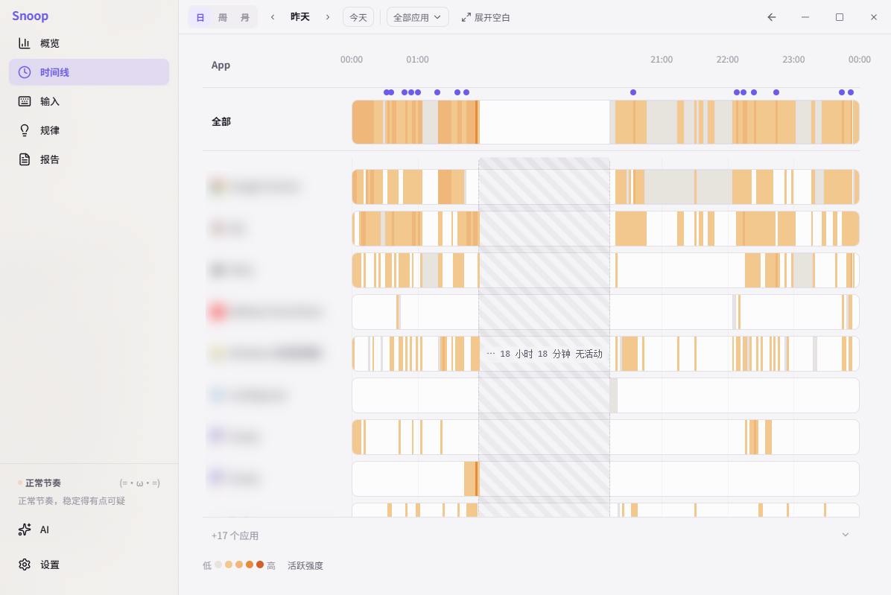

# Snoop

[中文](README.md) | English
[](https://github.com/Nerakolox/Snoop/releases)

[](LICENSE)

**Local-first activity tracker for Windows/macOS.** Snoop logs foreground app usage time, keyboard/mouse activity intensity, and per-key press-count heatmaps. It never records keystroke sequences, passwords, chat content, clipboard, or screenshots. All data stays on your machine in a local SQLite file — nothing is ever uploaded.

| Overview | Timeline | Keyboard heatmap |
| --- | --- | --- |
|  |  |  |

**Platforms**: Windows 10/11 · macOS 10.15+
**Brand**: Feedra · mascot is a cat with an attitude

---

## What it does

You spend eight or nine hours a day in front of your computer — but how much of it is real work versus switching apps thirty times and zoning out for two hours? Snoop quietly keeps score in the background and gives you a rundown at the end of the day:

- **Which apps ate your time today**
- **When you were actually active vs. just pretending to be busy**
- **What your keyboard/mouse intensity curve looks like** — bursts of heavy typing, mouse-clicking sprees, and dead-still stretches
- **A full week's activity heatmap**, so you can see how far your assumed routine drifts from your real one

Plus a snarky cat mascot watching over your shoulder, ready to call you out when you're slacking.

---

## Privacy boundary

Snoop **only records the frequency and intensity of key/mouse activity**. It never records:

- Which specific keys you pressed, in sequence (passwords, chat content, and search terms are never captured)
- Clipboard, screenshots, microphone, or camera
- Anything that would require a network upload

The database only ever contains granularity like "this app had N keystrokes and this many pixels of mouse movement in this 5-second window." The keyboard heatmap is built from de-sequenced per-key press counts — you cannot reconstruct what was typed from it.

This boundary does not bend for "smarter analytics." All data lives in a local SQLite file on your machine, and it's gone the moment you uninstall.

---

## Features

**Overview · today's snapshot**
A live status card (current app + intensity tier + a cat comment), today's numbers at a glance, an app usage ranking, and a 24-hour intensity heat strip.

**Timeline · swimlane Gantt view**
One row per app, time on the horizontal axis, colors fixed per app. Scroll to zoom, drag to pan, switch dates. Gaps longer than 2 hours auto-collapse into a gray block — time away from the keyboard doesn't take up space.

**Keyboard · heatmap**
Renders a real keyboard layout, with 40/60/68/87/98/104-key layouts built in and switchable with one click. Filterable by app and time range, with the keyboard, mouse, and top-keys panels linked. Coloring uses quantile buckets so a single overused key (looking at you, Enter) doesn't blow out the whole scale.

**Insights · weekly report**
A weekly trend bar chart, an app ranking with week-over-week change, and a 7×24 activity heat grid. Find out whether you're the "real work starts after 10pm" type or the "always slacking off Wednesday afternoon" type.

**Other**
Runs from the tray (keeps logging after the window is closed), optional launch-at-login, light/dark themes, an app ignore list, a toggle + snark-level slider for the cat's comments, and one-click data export/wipe.

---

## Download & install

Grab the installer for your platform from [Releases](https://github.com/Nerakolox/Snoop/releases):

- **Windows**: `Snoop_x.y.z_x64-setup.exe` — double-click to install. If SmartScreen blocks it, click "More info → Run anyway".
- **macOS Apple Silicon**: `Snoop_x.y.z_aarch64.dmg`
- **macOS Intel**: `Snoop_x.y.z_x64.dmg`

On first launch:

- **Windows**: works right away, no permission needed.
- **macOS**: you'll need to enable Snoop under **System Settings → Privacy & Security → Accessibility** (required for global keyboard/mouse monitoring). Gatekeeper may block the first launch — right-click → Open to bypass.

Auto-update is built in: on Windows, new versions download in the background and a "Restart to install" option appears in the tray menu; on macOS, you'll be prompted to open the download page and drag the new version over manually.

---

## FAQ

**Will this slow down my computer?**
No. Global monitoring goes through native OS channels (Raw Input on Windows, low-level event channels on macOS), and the event callback only does in-memory counting, batched to disk every 5 seconds. CPU usage is typically under 1%.

**Will it conflict with games or anti-cheat?**
The Windows build deliberately avoids low-level hooks and uses Raw Input instead — the same channel games themselves use to read keyboard input — so anti-cheat systems like EAC, Vanguard, etc. shouldn't (and don't) flag it. Snoop is a passive, read-only subscriber: it doesn't inject DLLs, read other processes' memory, or send any simulated input.

**Where is the data stored?**
- Windows: `%APPDATA%\org.feedra.snoop\`
- macOS: `~/Library/Application Support/org.feedra.snoop/`

It's a single SQLite file. Run it if you want, delete it if you don't.

**Can it sync to my phone or the cloud?**
No. That's a deliberate design choice, not an unfinished feature. A local tool should stay local.

**Does it support Linux?**
Not currently. It's not a target platform for this release.

---

## Building from source

You'll need Node 22+, Rust stable, and the platform build toolchain.

> **Node version**: Vite 7 requires Node 20.19+ / 22.12+. Node 18 will fail with
> `crypto.hash is not a function` and the Vite dev server won't start. Use
> `nvm use 22` (or equivalent) to switch to Node 22 first.

```bash
npm ci
npm run tauri dev       # dev mode
npm run tauri build     # build installers
```

- Windows builds require Visual Studio Build Tools (C++ desktop development workload)
- macOS builds require Xcode Command Line Tools (`xcode-select --install`)

For the release process and auto-update protocol, see [docs/打包与发布.md](docs/打包与发布.md) (Chinese).

---

## Tech stack

- **Frontend**: Tauri 2 + React 19 + TypeScript + Vite
- **Backend**: Rust (rusqlite for storage, rdev/Raw Input for capture, platform code isolated with `#[cfg]`)
- **UI**: custom components + semantic CSS variables for a light/dark theme system

---

## Brand & license

- Code license: [MIT](LICENSE), Copyright Feedra © 2026.
- The Snoop cat's look, name, and voice belong to this project. The code is open source, but please don't use the "Snoop" brand or mascot for a similar product.
